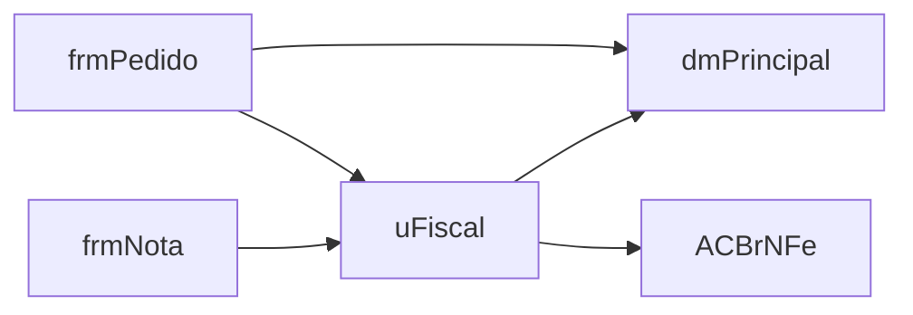

# Avaliação e registro de riscos

## Como ler o diagnóstico

| Sinal no diagnóstico | O que costuma significar | Impacto |
|---|---|---|
| Units com milhares de linhas | Responsabilidades misturadas; ninguém conhece a unit inteira | Bug difícil de achar; a IA gasta muitos tokens e perde contexto |
| Métodos grandes que são eventos de tela (`Sender: TObject`) | Regra de negócio dentro do `OnClick`/`OnExit` | Impossível testar sem abrir a tela; duplicação entre telas |
| DataModule com dezenas de datasets | "DataModule Deus": tudo depende dele | Qualquer mudança afeta o sistema inteiro; abre conexões e queries sem necessidade |
| Blocos duplicados | Copiar e colar entre telas/relatórios | Bug corrigido num lugar continua no outro |
| Unit com fan-in alto | Unit central (utilitários, DataModule principal) | Mudança nela tem risco alto; prioridade para testes |
| Pares que se usam mutuamente | Acoplamento circular via `implementation` | Ordem de inicialização frágil; difícil extrair módulos |
| Globais na interface | Estado compartilhado escondido | Efeitos colaterais, testes que dependem de ordem |
| `with` | Escopo ambíguo | Mudar uma classe muda silenciosamente qual propriedade é usada; o debugger não mostra |
| `except` vazio | Erros engolidos | Dados inconsistentes sem ninguém saber |
| `Application.ProcessMessages` | Reentrância (clique duplo processa duas vezes) | Bugs intermitentes difíceis de reproduzir |
| SQL espalhado no código | Acesso a dados misturado com tela | Troca de banco cara; SQL injection se concatenado |

## Custo em tokens: por que importa
Uma IA lê código em tokens (aproximadamente 4 caracteres cada). Uma unit de 15 mil linhas
pode passar de 150 mil tokens: lenta, cara e com risco de a IA "esquecer" o começo do arquivo.
Quebrar units gigantes não é só estética: torna o sistema legível para pessoas **e** para IAs.
Use o número de tokens do diagnóstico como argumento de prioridade com o time.

## Registro de riscos

Uma linha por risco. Probabilidade e impacto de 1 a 3; prioridade = probabilidade × impacto.

| # | Risco | Prob. | Impacto | Prior. | Sinal no código | Mitigação | Dono |
|---|---|---|---|---|---|---|---|
| R1 | Cálculo de impostos muda após refatoração | 2 | 3 | 6 | `uFiscal.pas` 9 mil linhas, cálculo no `btnCalcularClick` | Golden master com 200 notas reais antes de mexer | |
| R2 | Componente de terceiros sem versão para Delphi 13 | 2 | 3 | 6 | `TwwDBGrid` em 40 forms | Verificar fornecedor; plano B de substituição | |
| R3 | Quebra de integração fiscal (ACBr) | 1 | 3 | 3 | versão do ACBr de 2019 | `acbr-upgrade` em homologação antes | |
| R4 | Tela trava em produção após trocar acesso a dados | 2 | 2 | 4 | datasets abertos em `OnCreate` | teste de carga de forms; FetchOptions revisadas | |

Riscos típicos de sistemas Delphi para revisar sempre:
- Componentes de terceiros sem fonte ou sem suporte à versão de destino.
- Obrigações fiscais/legais (NF-e, NFC-e, SPED, TEF): exigem homologação, não só teste.
- Integrações por arquivo (layouts fixos, encoding ANSI): Unicode muda a gravação.
- Relatórios (QuickReport, Rave, FastReport antigos).
- Dados com encoding misto no banco (WIN1252 e UTF8 no mesmo lugar).
- Conhecimento concentrado em uma pessoa.
- Ausência de controle de versão ou de ambiente de homologação.

## Mapa de dependências
Para módulos críticos, desenhe (em texto ou Mermaid) quem usa quem, partindo das units com
maior fan-in. Exemplo:

O que tem mais setas chegando precisa de teste primeiro; o que tem menos setas saindo é mais fácil de extrair.
